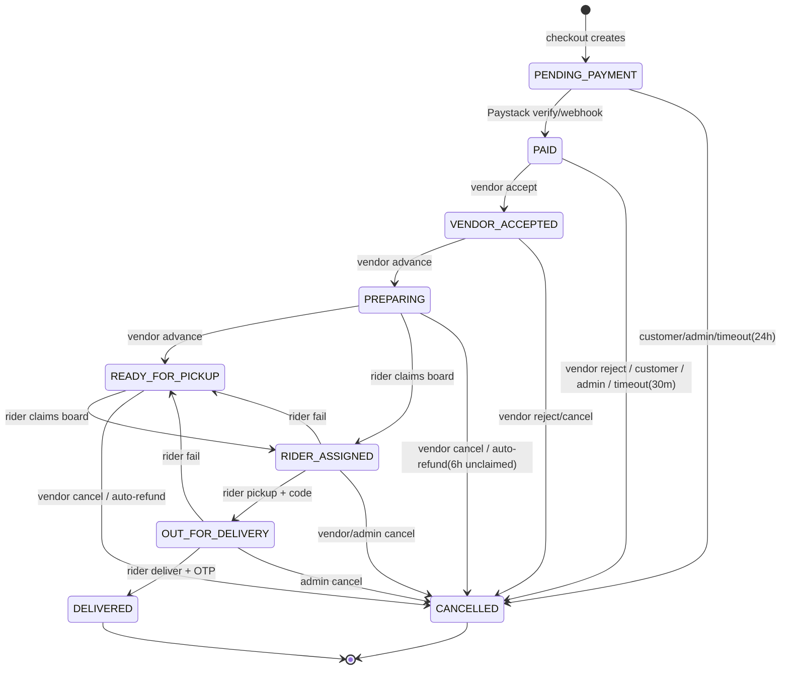
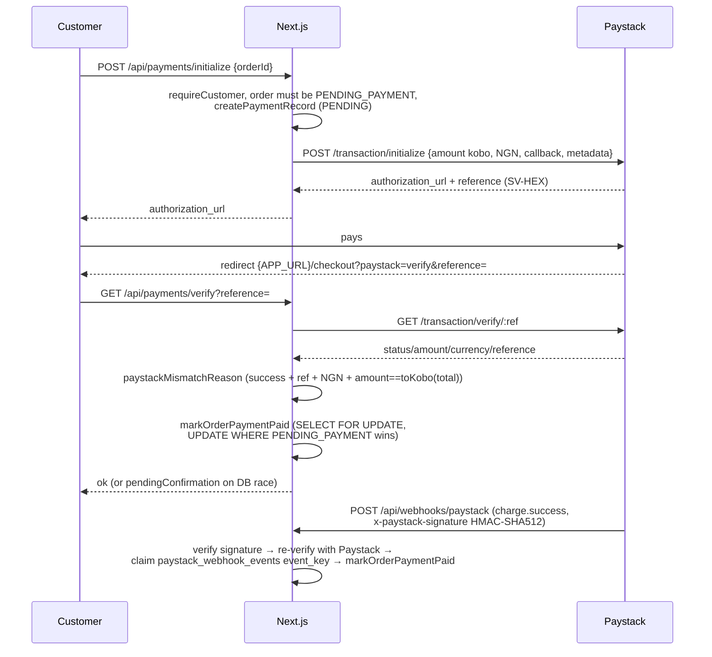

# Business Logic

## 1. Order lifecycle

### Statuses

`src/lib/order-types.ts:43-55`: `PENDING_PAYMENT, PAID, VENDOR_ACCEPTED, CONFIRMED, PREPARING, READY_FOR_PICKUP, RIDER_ASSIGNED, OUT_FOR_DELIVERY, DELIVERED, CANCELLED, REFUNDED`.
**`CONFIRMED` is legacy dead**: present in the type list but absent from `ORDER_TRANSITIONS`, and `app/api/vendor/orders/[id]/route.ts:14-15` comments "CONFIRMED is legacy status no writer produces". **No writer for order-status `REFUNDED` was found** — paid cancels write `CANCELLED` with `payment_status REFUNDED`.

### Transition map (enforced by `assertOrderTransition`, `src/server/order-transitions.ts:8-33`)

### Who triggers each + side effects

| Transition | Trigger (route → function) | Side effects |
|---|---|---|
| → `PENDING_PAYMENT` | `POST /api/orders/checkout` → `createOrdersFromCart` (`orders.ts:698`) | Reserve stock (`products.stock_quantity`), coupon `used_count+1`, `order_status_history`, cart cleared on payment (not here) |
| → `PAID` | `GET /api/payments/verify`, `POST /api/webhooks/paystack`, `scripts/reconcile-payments.ts` → `markOrderPaymentPaid` (`orders.ts:1206`) | `payments SUCCESS`, `upsertMoneySplit` + `recordTransactions CHARGE`, customer payment-confirmed mail + vendor new-order mail, history |
| → `VENDOR_ACCEPTED` | `PATCH /api/vendor/orders/[id]` action `accept` | Guarded `UPDATE … WHERE status='PAID'`, history, customer notify |
| → `PREPARING` / `READY_FOR_PICKUP` | same, action `advance` (`NEXT` map) | Guarded update, history, notify; `READY` calls stub `offerRiderJob` (no-op, board poll) |
| → `RIDER_ASSIGNED` | `POST /api/rider/jobs/accept` → `claimBoardJob` (`dispatch.ts:299`) | Atomic claim (`WHERE delivery_partner_id IS NULL AND payment PAID`), `deliveries ASSIGNED`, history, notify customer+vendor |
| → `OUT_FOR_DELIVERY` | `PATCH /api/rider/deliveries/[id]` action `pickup` | `deliveries PICKED_UP`, issue hashed customer code (`issueDeliveryCode orders.ts:360`), mails with code |
| → `DELIVERED` | same, action `deliver` (OTP, ≤5 attempts) | Same-tx order+delivery update, `creditRiderDeliveryTx`, `upsertMoneySplit`, `recordTransactions VENDOR_PAYOUT/RIDER_EARNING/PLATFORM_FEE`, `order_settlements PAYABLE`, `creditVendorForOrder`, delivered mails |
| → `READY_FOR_PICKUP` (fail path) | same, action `fail` | `deliveries FAILED`, order back to board, `delivery_partner_id=NULL`, possible cancelled-pickup fee (`wallet.ts:468`) |
| → `CANCELLED` | customer `POST /api/orders/[id]/cancel` (only PENDING_PAYMENT/PAID), vendor `reject`/`cancel`, admin `POST /api/admin/orders/[id]/cancel`, timeouts | Stock restore (`restoreStockForOrder:1496`), coupon release (`releaseCouponForOrder:1511`), void offers/deliveries, `refundOrderPayment` when paid (`refunds.ts:15`), history + notifies + (admin) `auditLog` |

Auto-timers (`orders.ts:104-121`): unpaid rot after **24h** (`PENDING_PAYMENT_TIMEOUT_MINUTES`), paid-but-unaccepted refund after **30m** (`VENDOR_ACCEPT_TIMEOUT_MINUTES`), claimable-but-unclaimed refund after **6h** (`UNCLAIMED_REFUND_HOURS`). Tunable via `order_config` (`resolveVendorAcceptTimeout:124` etc.).

Delivery sub-machine (`dispatch.ts:13-37`): `OFFERED→ASSIGNED→GOING_TO_VENDOR→ARRIVED_AT_VENDOR→PICKED_UP→IN_TRANSIT→DELIVERED` (plus `FAILED/CANCELLED` exits).

## 2. Payment flow (Paystack)

Amounts: naira in app, **kobo** on the wire: `toKobo = Math.round(naira*100)` (`orders.ts:433`), `nairaToKobo/koboToNaira` (`wallet.ts:80/87`).

- Init: `app/api/payments/initialize/route.ts:13`, `paystack.ts:78 initializePaystack`, ref format `SV-<16 HEX>` (`:74`). Failure marks payment `FAILED` (`:174`).
- Verify: `app/api/payments/verify/route.ts:23` — idempotent early return if already `PAID…DELIVERED` (`PAID_PROGRESSION:12`); else live verify + amount check (`paystackMismatchReason:132`).
- Webhook: `app/api/webhooks/paystack/route.ts:93` — raw body + `x-paystack-signature` (`verifyWebhookSignature:152`, HMAC-SHA512 + timing-safe); `transfer.*` → `handleTransferEvent`, else only `charge.success` (`:115`); re-verifies with Paystack before claiming `paystack_webhook_events.event_key ON CONFLICT DO NOTHING` (`:168`); `markOrderPaymentPaid` errors are logged only.
- Idempotency: `paystack_webhook_events(event_key UNIQUE)` (migration `007`), `orders.paystack_reference UNIQUE` (`017`), conditional `UPDATE … WHERE status='PENDING_PAYMENT'`.
- Failure handling: mismatch → human reason string, no state change; verify-DB race → `{pendingConfirmation:true}`; webhook handler never throws to Paystack.
- Reconciliation: `scripts/reconcile-payments.ts:1` (`--dry-run --limit --reference`): unpaid orders with non-FAILED payments → live `GET /transaction/verify` → require success+ref+NGN+amount → `markOrderPaymentPaid`. `npm run db:reconcile`.

## 3. Payout logic

Engine: `src/server/payouts.ts` (owner-agnostic) + ledger `src/server/wallet.ts` (polymorphic `(owner_type, owner_id)`) + rail `src/server/payments/transfers.ts`.

**How amounts are calculated.** On delivery: `upsertMoneySplit` + `recordTransactions` (`money.ts:94-115`: kinds `CHARGE/REFUND/VENDOR_PAYOUT/RIDER_EARNING/PLATFORM_FEE`); `order_settlements` → `PAYABLE`; `creditVendorForOrder` (`wallet.ts:353`: `vendor_net×100` kobo, `INSERT hold ON CONFLICT DO NOTHING`, `pending+=`); `creditRiderDeliveryTx` (`:409`: must run in delivery tx + confirmed; `fee = delivery_fee × share% + bonus`, frozen in `deliveries.rider_fee_kobo`). Split defaults (`money.ts:12`): commission 10%, rider share 100% of delivery fee, platform keeps service fee, not tax:
`commission = subtotal×pct/100; rider = deliveryFee×share/100; vendor = subtotal − commission; platform = commission + serviceFee? + tax? + (deliveryFee − rider)`.

**When payable.** Holds release after hold days: vendor default 2, rider default 1 (`WITHDRAWAL_LIMITS:47`, `RIDER_POLICY_FALLBACK:58`); per-owner overrides in `payout_config`. `releaseDueHolds` (`wallet.ts:566`) runs on `withdraw()` and converts due holds to `available`. Min ₦1,000 / max ₦500,000 per withdrawal; auto-approve below ₦50,000, else `awaitingApproval` with no Paystack call (`:47`, `payouts.ts:280-340`). Bank-account change starts a 24h cooling lock (`BANK_CHANGE_COOLING_HOURS_FALLBACK:66`, `isCoolingActive:173`); negative `available` blocks everything.

**How paid.** `POST /api/vendor|/rider/withdrawals` (`{amountKobo int>0, idempotencyKey?}`) → `withdraw()` → deduct + `INSERT withdrawals PENDING (reference SV-WD-HEX / idempotency UNIQUE)` → `initiateTransferAndRecord` (`POST /transfer {source:balance, amount kobo, recipient}`): success→SUCCESS, otp→OTP, else PROCESSING; ambiguous errors (timeout/network/429/5xx) → `markWithdrawalProcessing` (never auto-refund); insufficient funds → definitive + reverse (`transfers.ts:29-140`, `wallet.ts:803-896`). Transfer webhook (`applyTransferWebhook:840`) advances `nextWithdrawalStatus` (`success→SUCCESS, failed→FAILED, reversed→REVERSED, pending→PROCESSING, otp→OTP`); failures/reversals credit `available` back + `withdrawal_reversal` entry. Admin: `PATCH /api/admin/withdrawals/[id]` (approve → initiate + `approved_by` + audit; reject → reverse; bonus/penalty → `applyAdjustment`). Legacy aggregate endpoint `POST /api/admin/payouts` uses `gross=Σ(total)`, `commission=gross×rate/100`, `net=gross−commission−fees−paid` (UNVERIFIED whether still used — see KNOWN-ISSUES).

**Money state storage.** `wallets(owner_type,owner_id)` balances in kobo; `wallet_entries` append-only (kinds hold/release/withdrawal/withdrawal_reversal/adjustment/delivery_fee/tip/bonus/penalty; uniques on `(order_id,hold)` and `(delivery_id,kind)`); `withdrawals` (reference/transfer-code/idempotency unique); `order_money_splits`, `order_settlements`, `transactions`, `refunds`, `paystack_webhook_events` (migrations `005_otp`–`008`, `014`).

## 4. Verification (NIN/BVN)

**There is no NIN/BVN collection, storage, or verification provider.** Grep for `nin|bvn|kyc` across `src app scripts` = zero hits.
What exists instead:
- Email verification (24h single-claim tokens, `store.ts:241-294`).
- Password-reset tokens (30 min, hashed, single-claim) and delivery OTP hashes (4-digit, ≤5 attempts, `015_delivery_code_hash.sql`).
- Vendor `status` PENDING→APPROVED + `vendor_documents`; rider `verification_status` gate + `rider_documents` (license/ID/photo/vehicle docs, PENDING review).
- Bank-account ownership check via Paystack `resolveAccount` (10-digit Nuban + bank code, `transfers.ts:165`), not identity verification.
- Vendor profile photos are validated images, "never described as verified, never compared to government ID" (`storage/photos.ts:15-17`).
Who can see: documents/verification statuses are readable by the owning vendor/rider and admins (UNVERIFIED exact admin UI; routes exist under `/api/admin/vendors|riders`).

## 5. Pricing, fees, discounts, catering minimums

- Service fee: `computeServiceFee` (`orders.ts:413`): 0 if subtotal ≤ 0; FLAT → value; else `subtotal × min(value,100)/100`. Default 5% (`DEFAULT_PRICING:50`).
- Tax: `computeTaxAmount` (`:423`): `(subtotal − discount + serviceFee) × min(rate,100)/100`. Default 7.5%.
- Order total (`computeOrderTotals:437`): `subtotal=Σ(unit×qty)`; `discount=min(discount, subtotal+fee+service+tax)`; `total=subtotal+fee+service+tax−discount`. All `roundMoney` (2dp).
- Delivery fee: `getDeliveryFeeFor(city)` (`:684`): `locations.delivery_fee` case-insensitive match else **0**, per vendor order.
- Coupons (`:538-578, 630-746`): PERCENT `subtotal×min(value,100)/100`, FIXED `min(value,subtotal)`; active window + `usedCount<maxUses`; vendor-scoped coupons must match an order group; claimed atomically, released on cancel.
- Catering: `estimate = guestCount × pricePerGuest` (`CateringMarketplace.tsx:50`); only minimum is `catering_packages.minimum_guests`. No platform fee on catering observed (UNVERIFIED).
- Legacy admin payout math (`app/api/admin/payouts/route.ts:75`): `gross=Σ(total)`, `commission=gross×rate/100`, `net=gross−commission−fees−paid`.

## 6. Permissions matrix

Enforced by `src/server/auth/guard.ts` (`requireCustomer/Vendor/Admin(ADMIN+SUPER_ADMIN)/SuperAdmin`) + `proxy.ts` page gates. `ADMIN` can access vendor/rider pages; `SUPER_ADMIN` only explicitly listed areas.

| Capability | CUSTOMER | VENDOR | DELIVERY_PARTNER | ADMIN | SUPER_ADMIN |
|---|---|---|---|---|---|
| Browse/search/vendors/products (public) | ✅ | ✅ | ✅ | ✅ | ✅ |
| Cart/checkout/orders/track/cancel own | ✅ | ❌ | ❌ | ❌ (proxy blocks `/cart`,`/checkout`) | ❌ |
| Favorites/reviews (own, delivered) | ✅ | ❌ | ❌ | ❌ | ❌ |
| Catering request (own) | ✅ | ❌ | ❌ | ❌ | ❌ |
| Vendor products/variants/orders/catering-quotes/profile/payouts | ❌ | ✅ own | ❌ | ✅ (routes allow ADMIN) | ❌ |
| Vendor onboarding | ❌ | ✅ | ❌ | ❌ | ❌ |
| Rider jobs/claim/deliveries/locations/documents/profile/earnings | ❌ | ❌ | ✅ own | ✅ (rider pages allow ADMIN; jobs accept = DELIVERY_PARTNER only) | ❌ |
| `/dashboard` hub, `/account` | ✅ | ❌ | ❌ | ✅ | ✅ dashboard only |
| Admin: vendors/riders/products/orders/customers/coupons/categories/payouts/withdrawals/overview | ❌ | ❌ | ❌ | ✅ | ✅ |
| Super-admin: admins/analytics/audit/settings | ❌ | ❌ | ❌ | ❌ | ✅ |
| Payout bank list/resolve | ✅* customer? No — `VENDOR,DELIVERY_PARTNER,ADMIN,SUPER_ADMIN` only | ✅ | ✅ | ✅ | ✅ |

Public (no auth): categories, locations, health, products, vendors (+slug, +products), catering packages, `orders/track`, product reviews `GET`, `POST /api/email/unsubscribe` (HMAC token), `POST /api/webhooks/paystack` (HMAC signature).
