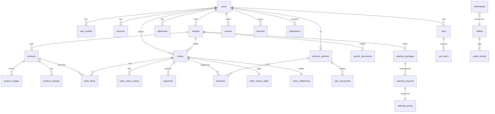

# Data Model

DB: Postgres. Migrations `src/server/migrations/` (18 files, applied in sorted order by `scripts/migrate.ts:11-74` with `schema_migrations` tracking). Client `src/server/db.ts:10-24` (postgres.js, `max:10`, SSL require, `prepare:false`).

Migration order: `001_init` → `002_roles_dashboards` → `003_coupon_code` → `004_pricing_fees` → `005_otp_settlement` + `005_vendor_accept` → `006_dispatch_delivery` → `007_vendor_withdrawals` → `008_polymorphic_wallets` → `009_vendor_profile_photos` → `010_dispatch_reliability` → `011_rider_presence_sync` → `012_email_updates_opt_out` → `013_vendor_open_and_dispatch_indexes` → `014_board_dispatch` → `015_delivery_code_hash` → `016_google_sub` → `017_paystack_reference`.

## ER diagram (core)

## Tables

Conventions: PKs are UUID (`id`), money `NUMERIC(12,2)` in app tables and **BIGINT kobo** in wallet tables, timestamps `TIMESTAMPTZ`. Field lists below are from migration SQL; `UNVERIFIED` = inferred from usage rather than `SELECT` of the file.

### Identity & sessions
- `roles(id UUID PK, name TEXT UNIQUE)` — seed `CUSTOMER,VENDOR,ADMIN,DELIVERY_PARTNER` (`001`). (`SUPER_ADMIN` used in code; UNVERIFIED whether seeded.)
- `users(id, email UNIQUE NOT NULL, phone, password_hash NOT NULL, first_name, last_name, role FK→roles(name), status CHECK ACTIVE/SUSPENDED/BANNED, email_verified_at, last_login_at; +012 email_updates_opt_out BOOL DEFAULT FALSE; +016 google_sub TEXT UNIQUE)`. Indexes: email, phone, role, created_at (`001`, `012`, `016`).
- `user_profiles(id, user_id UNIQUE FK CASCADE, avatar_url, bio, city/state/country)`.
- `sessions(id, user_id FK CASCADE, refresh_token_hash, user_agent, ip_address, expires_at, revoked_at)` + indexes user/refresh-hash/expires (`001`).
- `password_reset_tokens(id, user_id FK, token_hash, expires_at, used_at)` (`001`); `email_verification_tokens(id, user_id, token_hash, expires_at, used_at)` (`002`).
- `admin_permissions(user_id PK FK)` (`002`); `audit_logs(id, user_id FK SET NULL, action, entity_type/entity_id, meta JSONB, ip_address)` (`001`).

### Catalog & storefront
- `locations(id, name/state/city, is_active, delivery_fee NUMERIC(12,2), delivery_time_minutes, sort_order)` + `idx_locations_name`.
- `vendors(id, user_id FK CASCADE, business_name, slug UNIQUE, owner_name, phone, email, description/address/city/state, banner_image_url/logo_url, bank_name/bank_account_name/bank_account_number, status CHECK PENDING/UNDER_REVIEW/APPROVED/REJECTED/SUSPENDED; +002 commission_rate NUMERIC(5,2); +006/+008 recipient_code/bank_code/…/payout_account_changed_at; +009 profile_photo_key; +013 is_open BOOL DEFAULT TRUE)`. Indexes: slug, status, user_id, rating_average DESC.
- `vendor_documents(id, vendor_id FK CASCADE, kind CHECK CAC_CERTIFICATE/PROOF_OF_IDENTITY/BUSINESS_LOGO/VENDOR_LICENSE/OTHER, url, status CHECK PENDING/APPROVED/REJECTED, reviewed_at)`.
- `categories(id, name, slug UNIQUE, is_active, sort_order; +002 description)`; `vendor_categories(vendor_id, category_id PK composite, FKs CASCADE)`.
- `products(id, vendor_id FK CASCADE, category_id FK SET NULL, name, slug UNIQUE, description/short_description, price NUMERIC(12,2) CHECK≥0, compare_at_price/cost_price, image_url, ingredients JSONB, prep_info, availability BOOL, stock_quantity INT, rating_average NUMERIC(3,2), rating_count INT, is_featured/is_active BOOL, product_type CHECK FOOD/CAKE/SNACK/DRINK/CATERING)` + indexes slug/vendor/category/type/active/price/rating/created_at.
- `product_images(id, product_id FK CASCADE, url, is_primary, sort_order)`; `product_variants(id, product_id FK, name, price, stock, is_active)` (`002`).
- `vendor_staff(id, vendor_id FK, email, role)` + unique `(vendor_id, lower(email))` (`002`) — UNVERIFIED usage in routes.

### Cart, orders, delivery
- `carts(id, user_id UNIQUE FK CASCADE)`; `cart_items(id, cart_id FK CASCADE, product_id FK CASCADE, quantity INT CHECK>0, custom_instructions, UNIQUE(cart_id,product_id))`.
- `addresses(id, user_id FK CASCADE, label/recipient_name/phone/full_address/city/state/country/landmark, is_default)` + `idx_addresses_user_id`.
- `orders(id, order_number UNIQUE, user_id FK, vendor_id FK, address_id FK, status CHECK PENDING_PAYMENT/PAID/CONFIRMED/PREPARING/READY_FOR_PICKUP/OUT_FOR_DELIVERY/DELIVERED/CANCELLED/REFUNDED [+005 VENDOR_ACCEPTED] [+006 RIDER_ASSIGNED] [+010 dispatch_status DEFAULT PENDING_ASSIGNMENT] [+014 payout_bonus/escalated_at] [+015 delivery_code_hash] [+017 paystack_reference UNIQUE] [+004 service_fee/tax_amount] [+005_otp delivery_otp/require_otp] [+003 coupon_code] [+002 preferred_delivery_time], currency NGN, subtotal/delivery_fee/discount/total NUMERIC(12,2), payment_provider, payment_status CHECK PENDING/PAID/FAILED/REFUNDED, delivery_instructions, delivery_partner_id, cancelled_at/reason)` + indexes user/vendor/number/status/created_at/board (`014 idx_orders_board`).
- `order_items(id, order_id FK CASCADE, product_id FK SET NULL, name, unit_price/line_total, quantity CHECK>0)`; `order_status_history(id, order_id FK CASCADE, status, note, created_by FK SET NULL)`; `payments(id, order_id FK CASCADE, payment_reference UNIQUE, provider, status CHECK PENDING/SUCCESS/FAILED/REFUNDED, amount, currency, raw_payload JSONB, paid_at)`.
- `delivery_partners(id, user_id FK CASCADE, name, phone/vehicle_type/vehicle_number, status CHECK ACTIVE/OFFLINE/SUSPENDED [011 default OFFLINE]; +002 verification cols; +006 is_online/current_zone/last_active_at/last_assignment_at; +008 recipient/bank cols)`; `deliveries(id, order_id UNIQUE FK CASCADE, delivery_partner_id FK SET NULL, status CHECK ASSIGNED/PICKED_UP/IN_TRANSIT/DELIVERED/FAILED [+006 offer/arrived/going/code-hash/attempts/verified cols] [+008 rider_fee_kobo], tracking_note, assigned/picked_up/delivered_at)`; `delivery_offers(id, order_id, rider_id, status, expires_at)` (`006`) + `010 idx_delivery_offers_single_live`, `013` rider/deliveries-partner indexes; `rider_locations(id, delivery_partner_id, delivery_id, lat/lng, recorded_at)`; `rider_job_dismissals(order_id, delivery_partner_id UNIQUE)` (`014`); `rider_documents(id, delivery_partner_id FK, kind CHECK DRIVERS_LICENSE/PROOF_OF_IDENTITY/PROFILE_PHOTO/VEHICLE_DOCUMENT/OTHER, url, status, reviewed_at)` (`002`).

### Money
- `order_money_splits(order_id PK, …)` (`006`); `transactions(reference UNIQUE, …)` (`006`); `refunds(reference UNIQUE, …)` (`006`); `order_settlements(order_id PK UNIQUE FK, vendor_id, amounts, status)` (`005_otp`).
- `wallets(owner_type CHECK VENDOR|RIDER, owner_id, PK(owner_type,owner_id), balances BIGINT kobo)`; `wallet_entries(id, owner_type, owner_id, order_id?, delivery_id FK?, kind CHECK hold/release/withdrawal/withdrawal_reversal/adjustment/delivery_fee/tip/bonus/penalty, amount kobo, …; UNIQUE(order_id,hold), UNIQUE(delivery_id,kind))`; `withdrawals(id, owner_type, owner_id, reference UNIQUE, paystack_transfer_code UNIQUE, idempotency_key UNIQUE, amount kobo, status CHECK PENDING/PROCESSING/SUCCESS/FAILED/REVERSED/OTP, …)` — evolved `007 vendor_*` → `008` polymorphic.
- `paystack_webhook_events(event_key UNIQUE, …)` (`007`); legacy `vendor_payouts(id, vendor_id, reference UNIQUE, period, gross/commission/fees/net, status)` (`002`, UNVERIFIED current use).
- `platform_settings(key PK, value JSONB)` (`002`) — keys observed: `pricing_config`, `payout_config`, `order_config`, `delivery_config`/`dispatch_config` (UNVERIFIED exact key set), `payment/subscription/country/delivery/commission` (super-admin `KNOWN_KEYS`).

### Catering, promos, engagement
- `catering_packages(id, vendor_id FK CASCADE, title, slug UNIQUE, description, price_per_guest, minimum_guests INT, included_services/event_types JSONB, is_active)`; `catering_requests(id, package_id FK, user_id FK, vendor_id FK, full_name/phone/email/event_type/event_date DATE/event_location/guest_count CHECK>0/special_requirements, status CHECK SUBMITTED/UNDER_REVIEW/QUOTED/ACCEPTED/DECLINED/BOOKED/CANCELLED)`; `catering_quotes(id, request_id UNIQUE FK CASCADE, quote_amount/per_guest, message, status CHECK PENDING/ACCEPTED/DECLINED/EXPIRED, responded_at)`.
- `coupons(id, code UNIQUE, type CHECK PERCENT/FIXED, value, max_uses/used_count, starts/expires_at, is_active; +002 vendor_id FK CASCADE)`; `promotions(id, title/description/image_url, is_active, starts/ends_at)` — UNVERIFIED usage of `promotions`.
- `reviews(id, user_id FK CASCADE, order_id FK CASCADE, product_id FK CASCADE NULLABLE, vendor_id FK CASCADE, rating INT 1–5, comment, images JSONB, is_approved, UNIQUE(user_id,order_id,product_id,vendor_id))` + triggers `refresh_product_rating()/refresh_vendor_rating()` (`001:388-439`); `favorites(id, user_id FK, product_id FK, vendor_id FK, CHECK one NOT NULL)` + partial uniques; `notifications(id, user_id FK CASCADE, type, title, body, data JSONB, read_at)` + user index.

## Sensitive personal data

| Field group | Tables/fields | Protection in code |
|---|---|---|
| Credentials/secrets | `users.password_hash` (scrypt), `sessions.refresh_token_hash`, `*_tokens.token_hash`, `orders/deliveries.delivery_code_hash` (SHA-256) | hashes only; timing-safe compare (`password.ts`, `tokens.ts`, `dispatch.ts:45`, `orders.ts`) |
| Contact/identity | `users.email/phone/google_sub`, `vendors.phone/email`, `delivery_partners.phone`, `addresses.recipient_name/phone/full_address`, `catering_requests.full_name/phone/email/event_location` | auth-gated reads (owner/admin); no encryption at rest observed |
| Bank/payout | `vendors` + `delivery_partners` `bank_name/bank_account_name/bank_account_number/bank_code/recipient_code/payout_account_changed_at` | owner/admin-gated; cooling lock on change; Paystack recipient codes stored, not full card data |
| Location/device | `sessions.ip_address/user_agent`, `audit_logs.ip_address/meta`, `rider_locations.lat/lng`, `addresses.*` | session-gated; audit-logged |
| Payment payloads | `payments.raw_payload JSONB` | UNVERIFIED redaction — may contain gateway PII; see `SECURITY-AND-RISKS.md` |
| Photos/documents | `vendor_documents.url`, `rider_documents.url`, `vendors.profile_photo_key` (private S3 key, never public URL) | S3 private + short-lived signed views (`storage/*`); doc URLs UNVERIFIED (signed vs public) |
| Preferences | `users.email_updates_opt_out` | honored for delivered-mail (`email/index.ts:163-190`) |

**NOT stored:** NIN, BVN, card PANs, government IDs content (only document URLs + statuses).
