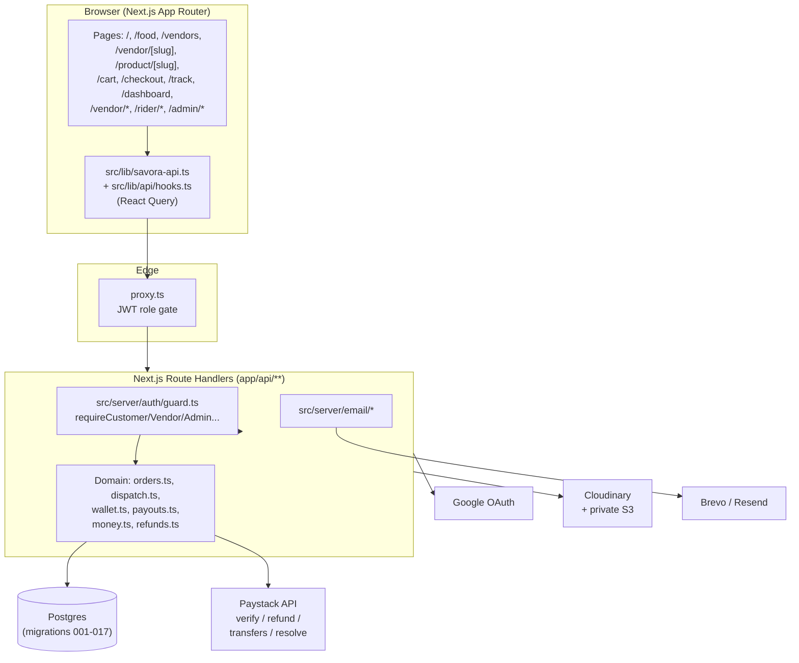

# Savora Food — Project Overview

> For: new developers (maintain the system) and the owner (plain-English view).
> Evidence-based. Every claim cites a file. `UNVERIFIED` = could not confirm from code/history.

## What Savora Food is (plain English)

Savora Food is a Nigerian online food marketplace. Customers browse food, cakes, snacks and drinks, order from independent vendors, pay online with Paystack, and get orders delivered by riders. Vendors manage their own menus and receive payouts to their bank accounts. Riders claim delivery jobs from an open board and earn delivery fees. There is also a catering marketplace where customers request quotes for events.

Live deployment target: Vercel. `SITE_URL`/`APP_URL` must be set to the stable production domain from the Vercel project settings (`src/lib/site-url.ts`, `.env.example`). (The old `savora-food.vercel.app` deployment was deleted — it must not appear in config or code.)

## Who the users are

| Role | Value in code | Home / dashboard | What they do |
|---|---|---|---|
| Customer | `CUSTOMER` | `/` ; hub at `/dashboard` | Browse, cart, checkout, track, catering requests, favorites, reviews |
| Vendor | `VENDOR` | `/vendor/dashboard` | Onboarding, products, orders (accept/reject), catering quotes, payouts, profile |
| Rider (delivery partner) | `DELIVERY_PARTNER` | `/rider/dashboard` | Claim jobs, pickup/deliver with OTP handover, earnings, withdrawals |
| Admin | `ADMIN` | `/admin/dashboard` | Approve vendors/riders/products, manage orders, coupons, payouts/withdrawals |
| Super admin | `SUPER_ADMIN` | `/super-admin/dashboard` | Manage admins, platform settings, audit log |

Role constants: `proxy.ts:5-11`, `src/server/auth/guard.ts:5-11`. Role home map: `proxy.ts:20-26`, `src/lib/role-routes.ts:19-57`.

### Main journeys

**Customer:** land on `/` (`app/page.tsx`) → category pages (`/food`, `/drinks`, `/snacks`, `/cakes`) or `/vendors`, `/search` → vendor page (`/vendor/[slug]`) or product page (`/product/[slug]`) → add to cart (`src/components/BuyBox.tsx`, `AddToCart.tsx`) → `/cart` → `/checkout` (address + coupon + per-vendor quote) → Paystack payment → `/track` + `/dashboard` (orders tab). Favorites via heart buttons (`src/components/FavoriteButton.tsx`). Reviews only after delivery (`src/components/ReviewForm.tsx`).

**Vendor:** register with role `vendor` (`app/auth/page.tsx`, `app/api/auth/register/route.ts:49-98`) → vendor profile auto-created with status `PENDING` (`src/server/auth/store.ts:79-108`) → `/vendor/onboarding` → wait for admin approval → manage products (`/vendor/products`), accept/reject orders (`/vendor/orders`), quote catering (`/vendor/catering`), withdraw earnings (`/vendor/payouts`, `/vendor/earnings` flows via `app/api/vendor/withdrawals/route.ts`, `app/api/vendor/recipient/route.ts`).

**Rider:** register with role `rider` → delivery-partner profile created `OFFLINE` (`src/server/auth/store.ts:110-123`) → onboarding/documents (`app/api/rider/documents/route.ts`) → go online → open jobs board (`GET app/api/rider/jobs/route.ts`, `src/server/dispatch.ts:231 findBoardJobs`) → claim (`POST app/api/rider/jobs/accept/route.ts`) → pickup with customer code → deliver with OTP verify (`PATCH app/api/rider/deliveries/[id]/route.ts`) → earnings/withdrawals (`app/api/rider/earnings`, `app/api/rider/withdrawals/route.ts`).

**Admin / Super admin:** manage via `/admin/*` and `/super-admin/*` pages backed by `app/api/admin/*` and `app/api/super-admin/*` routes (full inventory in `API.md`).

## Tech stack

| Layer | Choice | Evidence |
|---|---|---|
| Framework | Next.js 16.3.4 (App Router), React 19.2.8 | `package.json:21-24` |
| Language | TypeScript 5 | `package.json:38` |
| Styling | Tailwind CSS v4 (CSS-first, `@tailwindcss/postcss`), no `tailwind.config.*` | `package.json:29,36`, `postcss.config.mjs:3` |
| Data fetching (client) | TanStack React Query 5, stale 30s, retry 1 | `package.json:18`, `src/components/Providers.tsx:8-30` |
| Forms/validation | react-hook-form 7, zod 4 | `package.json:25-26` |
| Auth tokens | `jose` (JWT verify in middleware), Node `crypto.scrypt` passwords, SHA-256 opaque tokens | `proxy.ts:1`, `src/server/auth/password.ts:21-47`, `src/server/auth/tokens.ts:3-12` |
| Database | Postgres via `postgres` (postgres.js) driver, lazy singleton, SSL require, `prepare:false` | `src/server/db.ts:10-24` |
| Migrations | Hand-written SQL in `src/server/migrations/*.sql`, runner `scripts/migrate.ts` | `scripts/migrate.ts:11-74` |
| Tests | Vitest (node env, `tests/**/*.test.ts`) | `vitest.config.mts`, `package.json:10` |
| Icons | lucide-react | `package.json:20` |
| Image handling | `sharp` referenced for vendor photo pipeline (UNVERIFIED: not in `package.json` deps — see `KNOWN-ISSUES-AND-ROADMAP.md`) | `subagent evidence`, `src/server/storage/photos.ts` (UNVERIFIED exact import) |

## Third-party services and why each is used

| Service | Purpose | Key files | Env names only |
|---|---|---|---|
| Paystack (payments) | Card/bank checkout init + server-side verify + refunds | `src/server/payments/paystack.ts`, `app/api/payments/*`, `app/api/webhooks/paystack/route.ts`, `src/server/refunds.ts` | `PAYSTACK_SECRET_KEY`, `PAYSTACK_PUBLIC_KEY` |
| Paystack Transfers | Vendor/rider payouts to Nuban accounts + bank resolve/list | `src/server/payments/transfers.ts`, `src/server/payouts.ts`, `src/server/wallet.ts` | same as above |
| Brevo (preferred) / Resend (fallback) | Transactional email (verify, reset, OTP, order mails) | `src/server/email/index.ts:33-104` | `BREVO_API_KEY`, `RESEND_API_KEY`, `EMAIL_FROM` |
| Google OAuth | "Continue with Google" sign-in, verified-email linking | `src/server/auth/google.ts`, `app/api/auth/google/route.ts`, `app/api/auth/callback/google/route.ts` | `AUTH_GOOGLE_ID`, `AUTH_GOOGLE_SECRET` |
| Cloudinary | Generic image uploads (products etc.) when configured; else local `public/uploads/` (blocked on Vercel) | `src/server/cloudinary.ts`, `app/api/uploads/route.ts:7-68` | `CLOUDINARY_CLOUD_NAME`, `CLOUDINARY_API_KEY`, `CLOUDINARY_API_SECRET`, `CLOUDINARY_FOLDER` |
| Private S3 bucket | Vendor profile photos only (presigned POST → staging → validated finalize → private `vendors/*`; SSE-S3) | `src/server/storage/s3.ts`, `sigv4.ts`, `photos.ts` | `S3_BUCKET`, `S3_REGION`, `S3_ACCESS_KEY_ID`, `S3_SECRET_ACCESS_KEY` |
| NIN/BVN verification provider | **None. No NIN/BVN/KYC provider integration exists in code.** `grep -Ei \bnin\b|\bbvn\b|\bkyc\b src app scripts` returns zero hits. Rider/vendor "verification" = admin approval + document uploads + Paystack bank-account resolve. | — | none |
| Hosting | Vercel | `SITE_URL` default, `VERCEL` checks in upload route | `APP_URL`, `SITE_URL` |

Auth/session env: `DATABASE_URL`, `JWT_SECRET`, `JWT_ISSUER`, `ACCESS_TOKEN_TTL_MINUTES` (30), `REFRESH_TOKEN_TTL_DAYS` (30) — `src/server/env.ts:61-102`. Seed env: `ADMIN_SEED_EMAIL`, `ADMIN_SEED_PASSWORD`, `SUPER_ADMIN_SEED_EMAIL`, `SUPER_ADMIN_SEED_PASSWORD`, `RIDER_SEED_EMAIL`, `RIDER_SEED_PASSWORD`, `ALLOW_DEMO_SEED`, `SEED_ADMIN_ONLY` — `scripts/seed.ts`, `.env.example` UNVERIFIED for rider keys (seen in env grep).

## High-level architecture

Request path: page component → `savora-api.ts` fetch → `proxy.ts` (cookie `savora.access` JWT check + role redirect) → route handler (`requireCustomer`/`requireVendor`/`requireAdmin`) → domain function → Postgres. No `"use server"` server actions found (grep returned none — UNVERIFIED beyond grep).

## Folder structure explained

| Path | What lives there |
|---|---|
| `app/` | Routes. `page.tsx`/`layout.tsx` per segment; `api/**` = backend; `(group)` segments: `food|drinks|snacks|cakes`, `vendors`, `vendor/[slug]`, `product/[slug]`, `cart`, `checkout`, `track`, `dashboard`, `account`, `catering`, `vendor/*`, `rider/*`, `admin/*`, `super-admin/*`, `auth|login|register|forgot-password|reset-password|verify-email`, `sitemap.ts`, `robots.ts`, `email-preview/*`, `savora-backend/*` (UNVERIFIED purpose) |
| `src/server/` | Backend: `db.ts`, `env.ts`, `errors.ts`, `auth/*`, `payments/*`, `email/*`, `queries/*`, `storage/*`, `orders.ts`, `order-transitions.ts`, `dispatch.ts`, `wallet.ts`, `payouts.ts`, `money.ts`, `refunds.ts`, `notify.ts`, `vendors.ts`, `riders.ts`, `admin.ts`, `coupons.ts`, `cloudinary.ts`, `product-images.ts`, `migrations/*.sql` |
| `src/lib/` | Shared: `savora-api.ts` (API client), `api/hooks.ts`, `order-types.ts`, `catalog-params.ts`, `catalog-href.ts`, `role-routes.ts`, `site-url.ts` |
| `src/components/` | UI: `Providers.tsx`, `BuyBox.tsx`, `AddToCart.tsx`, `FavoriteButton.tsx`, `CatalogFilters.tsx`, `Marketplace*.tsx`, `CateringMarketplace.tsx`, `ReviewForm.tsx`, `ReviewsList.tsx`, `ui/toast.tsx`, `ui/confirm.tsx`, `Header*`, `Footer.tsx` (partial inventory — UNVERIFIED exhaustive) |
| `src/config/` | `site.ts` (`name Savora-Food, currency NGN`) |
| `scripts/` | `migrate.ts`, `seed.ts`, `reconcile-payments.ts` |
| `tests/` | 18+ vitest files (see `SETUP-AND-DEPLOYMENT.md`) |
| `proxy.ts` | Middleware role gate (named `proxy`, not `middleware`) |
| `public/` | Static assets incl. `favicon.png`, `savora-logo-wide.png` (referenced in SEO metadata) |

Cross-links: `TIMELINE.md` (history) · `FEATURES.md` (what each part does) · `BUSINESS-LOGIC.md` (money + lifecycle) · `DATA-MODEL.md` · `API.md` · `DESIGN-SYSTEM.md` · `SETUP-AND-DEPLOYMENT.md` · `SECURITY-AND-RISKS.md` · `KNOWN-ISSUES-AND-ROADMAP.md` · `DECISIONS.md` · `GLOSSARY.md`.
